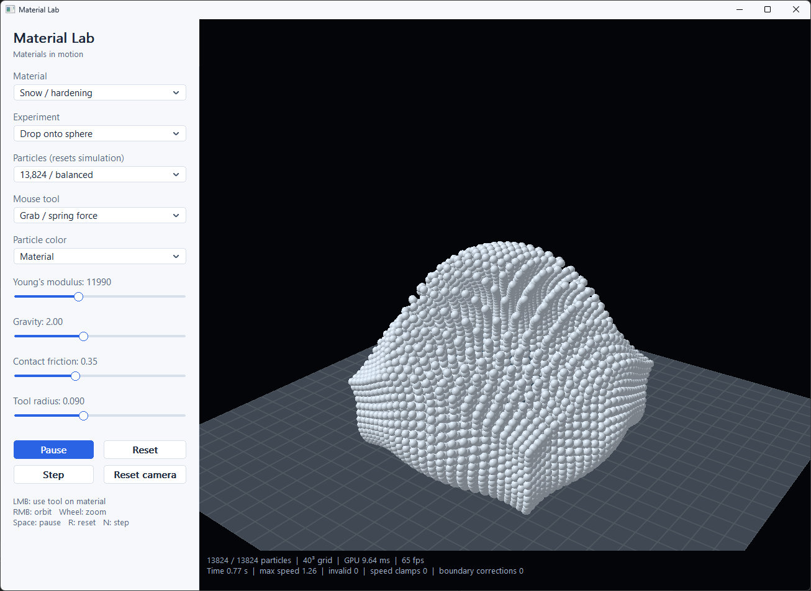

# Material Lab — 3D GPU Edition

The settings column uses native Windows controls with flat themed painting, scrolling and keyboard navigation (`ModernUI.hpp`); OpenGL renders into a child viewport window right of it. Simulation shortcuts apply when the 3D canvas has focus; focused controls use their native keys.

A native Windows laboratory for three-dimensional deformable materials. The complete simulation (MLS-MPM with APIC transfers) runs in OpenGL 4.3 compute shaders. C++23 supplies the WinAPI interface, camera, WGL context, dispatch scheduling and diagnostics. No third-party library, package manager, model, texture or external shader file is required.

## Build and run

The Windows x64 executable is `bin/x64/Release/MaterialLab.exe`. It requires an OpenGL 4.3 Core driver.

To rebuild, open `MaterialLab.slnx` in Visual Studio 2026 with Desktop development with C++, the v145 toolset and a Windows SDK. Select **Release | x64** and build the solution, or run `./Build.ps1` (add `-Configuration Debug` for a Debug build). Both configurations use the static Microsoft C++ runtime and compile at warning level 4. The minimum window size is 1080 × 760; the default is 1360 × 1000.

## Materials and scenes

- **Snow:** fixed-corotated elasticity, singular-value plastic projection and bounded exponential hardening.
- **Sand:** logarithmic elastic strain, Hencky stress and a noncohesive Drucker–Prager projection with a fixed 30-degree internal friction angle.
- **Clay:** fixed-corotated stress with bounded logarithmic volumetric strain and a deviatoric plastic-yield envelope.

Drop material onto a sphere, collide two blocks, or compress a block with a moving horizontal press. The domain includes frictional floor and side contacts. The press is kinematic and does not respond to reaction forces.

Choose 8,000, 13,824 or 32,768 particles. Each resolution represents the same initial material volume. Changing material, scene or particle count resets the experiment. Physical sliders preserve the current state.

## Controls

| Control | Action |
|---|---|
| Right mouse drag | Orbit camera |
| Mouse wheel | Zoom |
| Left mouse drag | Apply selected tool to visible material |
| Grab | Spring-like attraction and local damping |
| Cut | Delete particles inside the tool sphere |
| Push | Radial repulsive force |
| Space / Pause | Pause or resume |
| R / Reset | Reinitialize experiment |
| N / Step | Pause and advance one 1/1200-second substep |
| Reset camera | Restore original orbit |
| Escape | Close |

A GPU ray query selects the nearest particle on mouse-down and establishes a camera-facing interaction plane. Dragging moves the tool on that plane, preserving the selected depth. This hit test reads back one 32-bit depth value. Clicking empty space does not activate a tool. Tools act only while physics advances.

Slider ranges: Young's modulus 2,000–29,000; gravity 0–5; contact friction 0–1; tool radius 0.03–0.18. Density is 1,000. Initial volume is 0.36³ and particle mass equals density times particle volume. These are simulation units, not calibrated material measurements. Collider friction and sand's fixed internal friction angle are separate parameters.

## GPU pipeline

Particles and the 40 × 40 × 40 background grid live in shader storage buffer objects. Each particle occupies 128 bytes in std430: position/active flag, velocity/plastic-volume history, three padded deformation-gradient columns and three padded APIC-affine columns.

Each substep consists of four compute dispatches:

1. Clear grid momentum, mass and velocity.
2. **P2G:** evaluate 3D elastic stress and transfer mass, momentum and APIC affine motion to a 27-node quadratic B-spline stencil.
3. **Grid update:** normalize momentum; apply gravity, tool forces and frictional collision response.
4. **G2P:** interpolate velocity, reconstruct the affine field, advect particles, evolve the 3 × 3 deformation gradient and apply plastic projection.

The GPU computes the 3D SVD using five Jacobi sweeps on FᵀF. Every dispatch ends with GL_SHADER_STORAGE_BARRIER_BIT. Readbacks additionally use GL_BUFFER_UPDATE_BARRIER_BIT.

OpenGL 4.3 does not require native float atomic addition. P2G therefore implements atomic float sums with integer atomicCompSwap on SSBO words, including an atomic initial read. No vendor extension is required. This avoids fixed-point quantization and accumulation range limits. Concurrent summation order can vary, so results are not bitwise deterministic across runs or GPUs.

The fixed time step is 1/1200 second. Twenty substeps form a nominal 60 Hz simulation tick. The main loop accumulates real time and runs one tick per elapsed 1/60 s, at most one per rendered frame, so slow hardware slows simulated time rather than increasing the integration step. All physics runs on the GPU, including Debug builds; there is no CPU solver fallback.

Parameters reach the shaders through two `std140` uniform blocks, `Params` (particle count, material, scene, tool, brush, stiffness, gravity, friction, time and the picking ray; 112 bytes) and `View` (camera matrices; 128 bytes), mirrored by `material::Params` and `material::ViewParams` in `Model.hpp`. `Params` is uploaded once per substep, so the kinematic press and the tool see the current substep time and cursor position.

## Rendering and diagnostics

Instanced sphere impostors read particle positions directly from the SSBO. The fragment shader reconstructs normals and writes corrected sphere depth. Perspective, lighting, material/velocity/deformation coloring, a procedural floor and a lit collider make the 3D structure visible. Particle positions are not copied back to the CPU for rendering.

The status panel reports active particles, GPU physics time from timer queries, render FPS, simulated time, maximum speed, invalid states, speed caps and boundary corrections. A 64-byte diagnostics buffer is read twice per second. Error/correction counts accumulate until reset. Invalid state pauses interactive simulation at the next diagnostic check. Speed is capped at 8; final position clamping is an additional reported safeguard.

## Numerical scope

This is a fully 3D GPU simulator, not a physically calibrated engineering package. Clay's yield law is an educational approximation. Cutting removes mass rather than modeling fracture energy. Initial sampling uses a regular lattice. There is no watertight surface reconstruction, self-shadowing, adaptive CFL step, sparse grid, export, or mixed-material scene. Subgrid fracture and contact depend on grid resolution. Sphere impostors approximate silhouettes and are intended for particles small relative to camera distance.

## Source files

- `Main.cpp`: entry point and the fixed-timestep main loop.
- `App.hpp` / `App.cpp`: native window with the OpenGL viewport child, settings panel, camera and tool interaction, status line.
- `Simulation.hpp`: GPU resources, the four dispatches per substep, diagnostics, picking and rendering.
- `Model.hpp`: model constants, `Settings`, `Diagnostics`, the particle record and the uniform-block structs.
- `Shaders.hpp`: embedded GLSL 4.30 compute, vertex and fragment shaders as chunks.
- `GpuApi.hpp`: WGL context, the OpenGL 4.3 entry points and enumerants the lab uses, program building.
- `Math3D.hpp`: camera and perspective math.
- `ModernUI.hpp`: flat themed painting and scrolling for the native settings controls, plus the OpenGL viewport child.
- `MaterialLab.vcxproj` / `Common.props` / `Build.ps1`: Visual Studio 2026 C++23 project, shared compiler settings and the command-line build script.

Method references, not dependencies: [MPM snow](https://www.disneyanimation.com/publications/a-material-point-method-for-snow-simulation/), [MLS-MPM course](https://yuanming.taichi.graphics/publication/2019-mpm-tutorial/mpm-course-2019.pdf), [OpenGL compute](https://wikis.khronos.org/opengl/Compute_Shader), [SSBO atomics](https://wikis.khronos.org/opengl/Shader_Storage_Buffer_Object).
